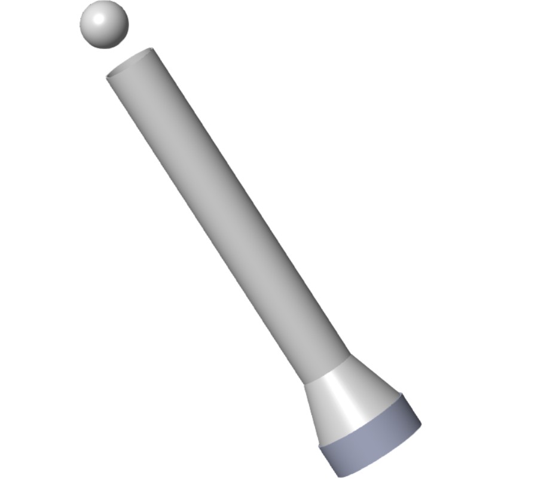

# Airflow-Based Ball Levitation System

A closed-loop aerodynamic levitation control platform engineered to suspend and stabilize a hollow sphere at a target setpoint inside a vertical transparent column. The system utilizes real-time distance feedback from an ultrasonic sensor, an embedded PID control algorithm executing on an Arduino microcontroller, and pulse-width modulated (PWM) blower fan actuation to maintain stable equilibrium in an inherently unstable aerodynamic environment.

---

## Visual Demonstration & CAD Model

### System CAD Assembly


### Prototype Demonstration
https://github.com/user-attachments/assets/media/MCS_Project_Working_Video.mp4

> **Working Video Demo:**
> <video src="media/MCS_Project_Working_Video.mp4" controls="controls" width="100%"></video>
> 
> *Direct link to download or view:* [▶ Watch Demonstration Video (media/MCS_Project_Working_Video.mp4)](media/MCS_Project_Working_Video.mp4)

---

## System Overview & Working Principle

Aerodynamic ball levitation is a classic benchmark in control systems engineering. Because gravity constantly acts downward while aerodynamic lift increases nonlinearly with air velocity, an uncontrolled ball inside a tube will either drop to the base when airflow is insufficient or accelerate out the top when airflow is excessive.

The system stabilizes this equilibrium through a continuous closed-loop control architecture:

1. **Position Sensing:** An HC-SR04 ultrasonic sensor mounted at the top of the tube continuously measures the distance to the ball's surface using acoustic time-of-flight.
2. **Error Computation:** The microcontroller samples the ball position at discrete intervals ($T_s$), compares it to the programmed setpoint height ($r$), and computes the positional error:
   $$e[k] = r - x[k]$$
3. **PID Computation:** The digital controller computes corrective effort using Proportional, Integral, and Derivative actions:
   - **Proportional ($K_p$):** Delivers immediate restoring force based on instantaneous displacement from the setpoint.
   - **Integral ($K_i$):** Accumulates past steady-state error over time to eliminate persistent height offsets caused by aerodynamic variations or battery discharge.
   - **Derivative ($K_d$):** Provides essential damping by reacting to the rate of change of error, dissipating kinetic energy to suppress oscillations.
4. **Actuation:** The computed control command is constrained and converted into a PWM signal driving an L298N motor driver / ESC, modulating the 12V blower fan's rotational speed and column airflow velocity to hold the ball steadily at the target height.

---

## Mathematical Modelling

### 1. Vertical Equation of Motion
Applying Newton's second law to the ball along the vertical axis:
$$m \ddot{x}(t) = F_{\text{lift}}(u) - m g - F_{\text{drag}}(\dot{x}(t))$$

Where:
- $m$: Mass of the hollow ball ($45\text{ mm}$ diameter)
- $x(t)$: Vertical position of the ball from the tube base ($m$)
- $g$: Acceleration due to gravity ($9.81\text{ m/s}^2$)
- $F_{\text{lift}}(u)$: Aerodynamic lift force as a function of PWM input $u$
- $F_{\text{drag}}$: Viscous drag force opposing ball velocity

Aerodynamic lift is proportional to the square of the airflow velocity, which relates to fan PWM input:
$$F_{\text{lift}}(u) \approx K \cdot u^2$$
*(where $K$ is the aerodynamic coupling constant dependent on tube cross-section, ball diameter, and nozzle geometry).*

### 2. Linearization & Transfer Function
Linearizing about the equilibrium operating point $(x_0, u_0)$ where $K u_0^2 = m g$:
$$m \Delta \ddot{x}(t) \approx 2 K u_0 \Delta u(t)$$

Defining the linearized actuator gain $B = \frac{2 K u_0}{m}$:
$$\Delta \ddot{x}(t) = B \Delta u(t)$$

Taking the Laplace transform with zero initial conditions yields the open-loop transfer function:
$$G(s) = \frac{X(s)}{U(s)} = \frac{B}{s^2}$$

The open-loop plant behaves as a **double integrator** with two poles at the origin ($s = 0$), confirming that the open-loop system is marginally stable and requires active derivative damping from the PID controller to achieve closed-loop stability.

---

## Hardware Specifications

### Mechanical Components
| Component | Specification / Dimensions | Function |
| :--- | :--- | :--- |
| **Levitation Tube** | Acrylic, $55\text{ mm}$ ID, $300\text{ mm}$ length | Enclosed vertical levitation chamber |
| **Levitation Object**| Hollow lightweight ball, $45\text{ mm}$ diameter | Levitation target ($5\text{ mm}$ radial clearance) |
| **Airflow Nozzle** | Custom tapered inlet | Directs and focuses blower airflow into column |
| **Structural Frame** | Base plate and vertical supports | Rigid mechanical isolation and sensor alignment |

### Electrical & Electronic Hardware
| Component | Model / Rating | Function |
| :--- | :--- | :--- |
| **Microcontroller** | Arduino Uno (ATmega328P) | Real-time sensor acquisition & PID loop execution |
| **Distance Sensor** | HC-SR04 Ultrasonic Sensor | Non-contact ball position tracking (top-mounted) |
| **Blower Actuator** | 12V DC High-Speed Centrifugal Blower | Aerodynamic airflow column generation |
| **Driver Stage** | L298N Dual H-Bridge Motor Driver Module | PWM voltage regulation to blower fan |
| **Power Source** | 12.4V 2000 mAh LiPo Battery | High-discharge power supply for driver & logic |
| **Flyback Diode** | 1N4007 Diode | Back-EMF suppression across inductive motor coils |

---

## Wiring & Electrical Schematic

```
                   +------------------------+
                   |  12.4V LiPo Battery   |
                   +-----------+------------+
                               |
                        +------+------+
                        | (12V)       | (GND)
                        v             v
                 +---------------------------+
                 |    L298N Motor Driver     +----> [ 1N4007 Diode || 12V Blower Fan ]
                 +---+-------------------+---+
                     | 5V Out            | Common GND
                     v                   v
+--------------------+-------------------+--------------------+
|                      Arduino Uno (5V & GND)                 |
|                                                             |
|   Pin D7 (or D9)  --------------------> HC-SR04 TRIG Pin    |
|   Pin D6 (or D10) <-------------------- HC-SR04 ECHO Pin    |
|   Pin D9 (PWM)    --------------------> L298N / Driver PWM  |
|   Pin D8 / D7     --------------------> L298N Direction IN |
+-------------------------------------------------------------+
```

### Pin Assignments
- **HC-SR04 Ultrasonic Sensor:**
  - `VCC` $\rightarrow$ Arduino `5V`
  - `GND` $\rightarrow$ Arduino `GND`
  - `TRIG` $\rightarrow$ Arduino Digital Pin (configured in firmware)
  - `ECHO` $\rightarrow$ Arduino Digital Pin (configured in firmware)
- **Motor Driver Interface:**
  - `PWM / Speed` $\rightarrow$ Arduino PWM-capable pin (e.g., Pin 9)
  - `GND` $\rightarrow$ Common system ground

> **Electrical Protection Note:** Inductive switching spikes from the DC blower motor can induce severe electromagnetic interference (EMI) and voltage transients. A 1N4007 rectifier diode must be connected across the blower motor terminals in reverse-bias (cathode to $+12\text{V}$) to provide flyback protection.

---

## Repository Structure

```
.
├── cad/                                # SolidWorks CAD models and neutral exchange formats
│   ├── System_final_assembly.SLDASM    # Complete SolidWorks 3D system assembly
│   ├── Ball_40mm_Default_sldprt.STEP   # 40/45mm levitation sphere STEP file
│   ├── Fan_Default_sldprt.STEP         # Centrifugal blower housing & impeller STEP file
│   ├── housing_Default_sldprt.STEP     # Actuator base housing STEP file
│   ├── Transparent_tube_Default_sldprt.STEP # 300mm transparent levitation tube STEP file
│   └── Tube_nozzle_Default_sldprt.STEP # Transition nozzle STEP file
├── firmware/                           # Embedded control firmware
│   └── mcs_code.ino                    # Arduino closed-loop PID control sketch
├── docs/                               # Technical reports and documentation
│   └── Ball_Levitation_System_report.pdf # Complete engineering design and simulation report
├── media/                              # Media and demonstration assets
│   ├── report_cad_model.png            # Isometric CAD render of the assembly
│   └── MCS_Project_Working_Video.mp4   # Physical prototype demonstration recording
├── .gitattributes                      # Git LFS tracking configuration for large binaries
├── .gitignore                          # Optimized exclusions (MATLAB/Simulink, CAD temps, OS)
└── README.md                           # Technical documentation
```

---

## Control Firmware & Operation

The embedded firmware ([mcs_code.ino](firmware/mcs_code.ino)) implements a discrete PID controller with real-time serial monitoring.

### Key Control Features
- **Anti-Windup Protection:** Integrator accumulator is clamped to prevent actuator saturation windup during startup transients.
- **Serial Setpoint Control:** Allows on-the-fly setpoint configuration and emergency shutdown via the Serial Monitor.
- **Sensor Filtering & Guard:** Echo duration timeout protection and boundary checking ensure acoustic reflections do not trigger erratic jumps.

### Firmware Configuration & Tuning Parameters
```cpp
// Baseline PID Tuning Values (Refined from simulation and physical testing)
float Kp = 30.0;   // Proportional gain for rapid positional correction
float Ki = 3.0;    // Integral gain to eliminate steady-state error
float Kd = 12.0;   // Derivative gain for aerodynamic damping
```

### Serial Monitor Commands
Open the Arduino Serial Monitor at **9600 baud**:
- Send a target height in centimeters (e.g., `15` for $15\text{ cm}$) to activate the control loop and set the target levitation position.
- Send `100` or `-` to trigger an immediate emergency stop (kills blower power).

---

## Setup & Deployment Instructions

### 1. Mechanical Assembly
1. Mount the blower fan firmly at the base of the frame to prevent vibration transmission into the column.
2. Secure the transition nozzle directly above the blower exhaust to ensure laminar airflow entry.
3. Align the transparent acrylic tube vertically above the nozzle. Any angular tilt introduces wall friction that degrades PID stability.
4. Mount the HC-SR04 ultrasonic sensor centrally at the top tube opening pointing downward into the tube bore, isolated from frame vibration using foam or rubber grommets.

### 2. Electrical Setup
1. Verify common ground between the LiPo battery negative terminal, L298N driver ground, and Arduino Uno ground.
2. Check the polarity of the 1N4007 flyback diode across the fan terminals.
3. Confirm that the 5V logic supply from the driver board regulator provides steady 5.0V before connecting the Arduino board and sensor.

### 3. Firmware Flashing
1. Connect the Arduino Uno to your workstation via USB.
2. Open [firmware/mcs_code.ino](firmware/mcs_code.ino) in the Arduino IDE.
3. Select board: **Tools > Board > Arduino Uno** and select the active COM port.
4. Compile and upload the sketch.

### 4. Controller Tuning Sequence
1. **Open-Loop Test:** Command a fixed mid-range PWM to confirm the fan generates sufficient dynamic pressure to lift the ball off the base.
2. **Proportional Tuning ($K_p$):** Set $K_i = 0$ and $K_d = 0$. Increment $K_p$ until the ball rises and begins oscillating around the setpoint.
3. **Derivative Damping ($K_d$):** Gradually increase $K_d$ until oscillations are suppressed and the ball decelerates smoothly as it nears the setpoint.
4. **Integral Elimination ($K_i$):** Introduce small values of $K_i$ to pull the ball to the exact setpoint height and eliminate any residual offset.
